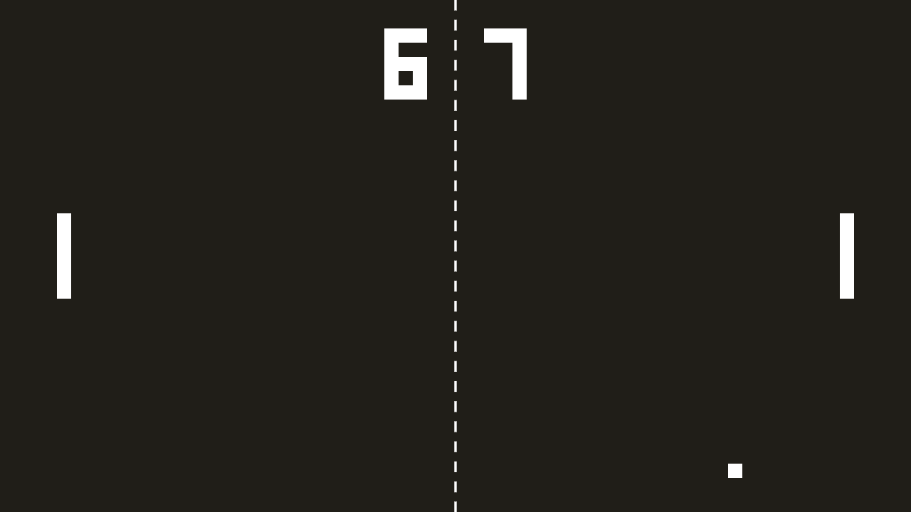

# Ping Pong in Love2D



Basically like [ping-pong-love](https://github.com/tsoding/ping-pong-love) but finished lol.

## Quick Start

Install [LÖVE](https://love2d.org/) and [Teal](https://teal-language.org/)

```console
$ tl gen main.tl
$ love .
```

## Controls

#### Keyboard

| Keys | Description |
|---|---|
| <kbd>W</kbd> | Move left paddle up |
| <kbd>S</kbd> | Move left paddle down |
| <kbd>Up</kbd> | Move right paddle up |
| <kbd>Down</kbd> | Move right paddle down |
| <kbd>Space</kbd> | Pause/unpause |

#### Gamepad

If two or more gamepads are plugged into the computer the game will try to detect them and assign them to each paddle. Which one will be assigned to which paddle is undefined. You have to figure that out by experimenting.

| Buttons | Description |
|---|---|
| Gamepad 1 <kbd>D-Pad Up</kbd> | Move left paddle up |
| Gamepad 1 <kbd>D-Pad Down</kbd> | Move left paddle down |
| Gamepad 1 <kbd>Start</kbd> | Pause/unpause |
| Gamepad 2 <kbd>D-Pad Up</kbd> | Move right paddle up |
| Gamepad 2 <kbd>D-Pad Down</kbd> | Move right paddle down |
| Gamepad 2 <kbd>Start</kbd> | Pause/unpause |
